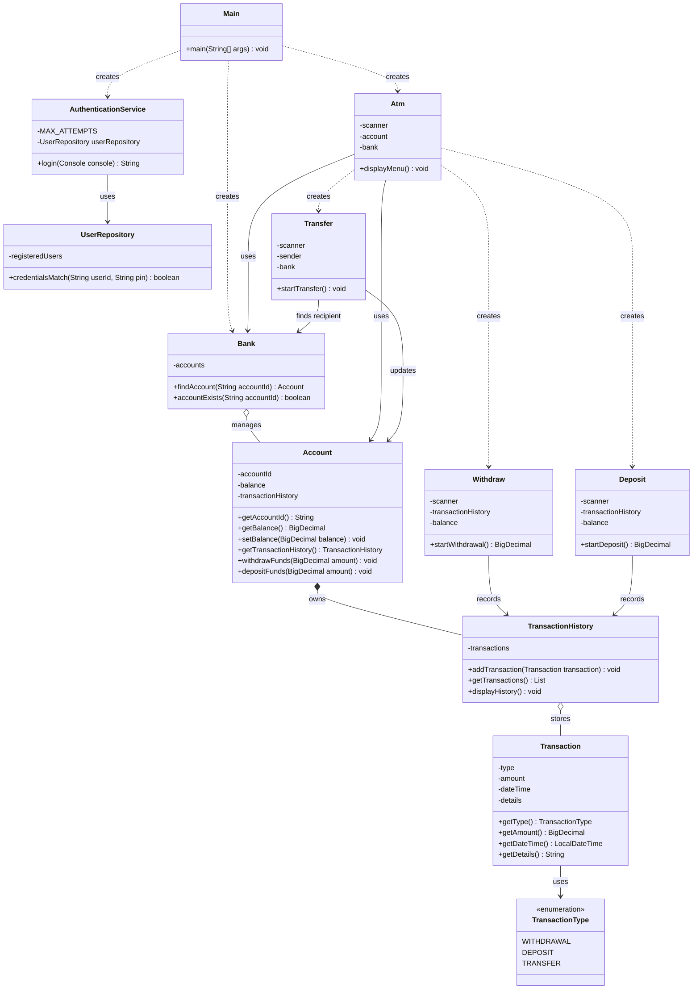

# ATM Interface – Java Console Application

A console-based ATM simulation developed using Java and Object-Oriented Programming (OOP) principles as part of the Oasis Infobyte Java Development Internship.

The application supports user authentication, cash withdrawals, deposits, account-to-account transfers, and transaction history management.

## 1. Project Overview

The ATM Interface simulates basic ATM operations through a command-line interface. Users authenticate using their User ID and PIN before accessing the ATM menu.

The project demonstrates Java concepts such as:

- Object-Oriented Programming
- Encapsulation
- Classes, objects, constructors, and methods
- Collections using `ArrayList` and `HashMap`
- Exception handling
- Input validation
- Transaction management
- Java `BigDecimal` for monetary calculations

## 2. Internship Task Details

**Task:** Task 3 – ATM Interface

**Objective:** Build a console-based simulation of an ATM machine that allows users to authenticate with a PIN and perform standard banking transactions.

**Tech Stack:** Java (console application, Object-Oriented design with multiple classes).

### Original Feature Requirements

- Startup prompt for User ID and PIN.
- Deny access after three incorrect login attempts.
- Display the main menu after successful authentication.
- Transaction History – display transactions recorded during the current session.
- Withdraw – validate the withdrawal amount and available balance.
- Deposit – validate the deposit amount and update the account balance.
- Transfer – validate recipient account and available balance, update both accounts, and record transactions.
- Quit – display a goodbye message and exit.
- Store transactions using an `ArrayList`.
- Use at least five distinct Java classes.

## 3. Technologies Used

| Technology                  | Purpose                                   |
| --------------------------- | ----------------------------------------- |
| Java                        | Application development                   |
| JDK 21                      | Java development and execution            |
| Object-Oriented Programming | Application structure                     |
| ArrayList                   | Transaction history storage               |
| HashMap                     | User credentials and bank account storage |
| BigDecimal                  | Monetary calculations                     |
| Java Console API            | Secure PIN input                          |
| Git                         | Version control                           |

No external Java libraries or frameworks are required.

## 4. Features Implemented

### User Authentication

- Login using User ID and four-digit PIN.
- Case-insensitive User ID matching.
- PIN input using Java Console's hidden password input.
- Maximum of three login attempts.
- Access denied after unsuccessful authentication.

### ATM Menu

After successful authentication, users can access:

1. Transaction History
2. Withdraw
3. Deposit
4. Transfer
5. Quit

### Cash Withdrawal

- Minimum withdrawal: ₹100.
- Maximum withdrawal: ₹25,000 per transaction.
- Withdrawal amounts must be multiples of ₹100.
- Checks available account balance.
- Requires transaction confirmation.
- Generates a withdrawal receipt.
- Supports repeated withdrawals.

### Cash Deposit

- Minimum deposit: ₹100.
- Maximum deposit: ₹50,000 per transaction.
- Deposit amounts must be multiples of ₹100.
- Requires transaction confirmation.
- Generates a deposit receipt.

### Money Transfer

- Transfer funds between existing accounts.
- Prevents transfers to the same account.
- Validates the recipient account.
- Minimum transfer: ₹100.
- Maximum transfer: ₹25,000 per transaction.
- Transfer amounts must be multiples of ₹100.
- Checks sender's available balance.
- Updates sender and recipient balances.
- Records transfer transactions in both accounts' histories.

### Transaction History

- Stores transaction records using `ArrayList`.
- Records transaction type, amount, date and time, and details.
- Displays withdrawal, deposit, and transfer records.
- Maintains separate transaction histories for individual accounts.

## 5. Project Structure

The application contains 11 Java source files.

| File                         | Responsibility                                         |
| ---------------------------- | ------------------------------------------------------ |
| `Main.java`                  | Application entry point and initialization             |
| `AuthenticationService.java` | Handles user authentication                            |
| `UserRepository.java`        | Stores and validates demo login credentials            |
| `Bank.java`                  | Manages bank account objects                           |
| `Account.java`               | Maintains account ID, balance, and transaction history |
| `Atm.java`                   | Displays the ATM menu and coordinates operations       |
| `Withdraw.java`              | Handles withdrawal operations                          |
| `Deposit.java`               | Handles deposit operations                             |
| `Transfer.java`              | Handles money transfers between accounts               |
| `Transaction.java`           | Represents individual transactions                     |
| `TransactionHistory.java`    | Stores and displays transaction records                |

## 6. UML Class Diagram

The following diagram illustrates the main classes and their relationships.



## 7. Demo Login Credentials

The following demonstration accounts are initialized in the application.

| User ID | PIN  | Opening Balance |
| ------- | ---- | --------------: |
| USER001 | 1234 |         ₹50,000 |
| USER002 | 5678 |         ₹50,000 |
| USER003 | 9012 |         ₹50,000 |

**Security note:** These are demonstration credentials stored in the application's source code. They are not suitable for a production banking application.

## 8. How to Run the Project

### Prerequisites

- Java Development Kit (JDK 21 recommended).
- Windows Command Prompt or PowerShell.
- A terminal that supports Java Console input.

Verify Java installation:

```cmd
java -version
javac -version
```

### Step 1: Open the project directory

Navigate to the directory containing the Java source files:

```cmd
cd /d D:\Oasis_Intership\JavaDevelopment-Task3-ATMInterface
```

### Step 2: Compile the Java files

```cmd
javac *.java
```

### Step 3: Run the application

```cmd
java Main
```

**Important:** Run the application directly in Command Prompt or PowerShell. The application uses `System.console()` for hidden PIN input, which may not be available in some IDE output consoles.

## 9. Transaction Storage

- User credentials and bank accounts are initialized in memory when the application starts.
- Transaction histories are maintained using `ArrayList`.
- Each account has its own transaction history.
- Transactions remain available during the current application session.
- Transaction history is not currently saved to a JSON file or database.
- Restarting the application resets the demo account balances and transaction histories to their initial values.

## 10. Project Limitations

This project is an educational ATM simulation, not a production banking system.

Current limitations include:

- Demo credentials are stored in plaintext in the source code.
- Account information is maintained in memory.
- Transaction records are not persisted across application restarts.
- The application does not connect to a real banking service or payment gateway.
- There is no production-grade authorization or security infrastructure.

## 11. Learning Outcomes

Through this project, the following Java concepts and development practices were applied:

- Designing applications using multiple classes.
- Implementing encapsulation and data validation.
- Using `ArrayList` and `HashMap`.
- Handling monetary values with `BigDecimal`.
- Managing transactions and account balances.
- Implementing authentication and input validation.
- Organizing application responsibilities across multiple classes.

## 12. Internship Information

**Organization:** Oasis Infobyte  
**Internship:** Java Development Internship  
**Project:** Task 3 – ATM Interface  
**Language:** Java

---

_Developed as part of the Oasis Infobyte Java Development Internship._
